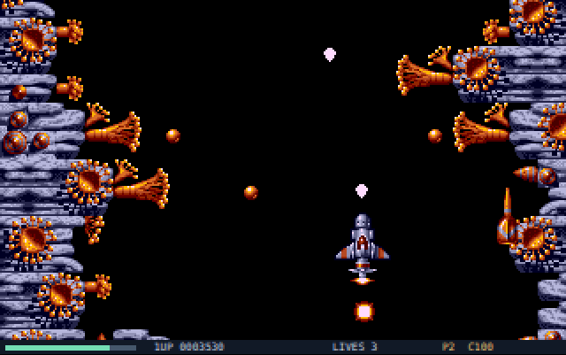

# 🚀 Xenon 2: Megablast in your browser

A native JavaScript and Canvas 2D port of **Xenon 2: Megablast**, with all five
stages and local two-player play. No emulator or build step is needed to play
locally.



**💾 Bring your own DOS game files.** The game data and audio aren't included in
this repository, and no public build is hosted.

## Run

You'll need **Node.js 20+** and your own copy of the original DOS game.
Clone the repository, then copy the files into these locations:

| Where | Files |
| --- | --- |
| Project root | `XENON2.EXE`, `X2SPR.DAT`, `X2WEAPS.DAT`, `GR.DAT`, `SHOP.DAT` |
| Each stage folder (`S1` through `S5`) | `MODS.VGA`, `SPRITES.VGA`, `MAP.CMP`, `EVENTS.PC`, `EVENTSBG.PC`, `PATHS.BIN` |

From the project root:

```sh
npm start
```

Open <http://127.0.0.1:8080>. There's nothing to install or build. The server
only listens on your machine; use `PORT=8081 npm start` for a different port.

🎵 Sound is optional. See [Recovered Amiga audio](#recovered-amiga-audio) to
add the soundtrack and effects. To package the game for a static server,
see [Build a standalone folder](#build-a-standalone-folder).

## Headless gameplay and frame capture

The headless runner uses the same game simulation and renderer in Node.js, without
a browser, display, audio, or running web server. It supports external controllers
and an initial Foundry Local AI player. It still needs the DOS files listed above.
Install the development dependencies for PNG capture:

```sh
npm ci
npm run headless -- --ticks 1100 --decision-ticks 4 --seed 0x5845 --output captures/demo
```

This holds fire for up to 1100 gameplay ticks (about 60 seconds), running as fast
as simulation and PNG encoding allow. This baseline stops at shops, Get Ready after losing
a life, continue/high-score screens, or the end of a run; it does not automatically
make menu choices.
The output directory must not already exist. `captures/` is gitignored.
Omit `--output` for simulation and JSON observations only, which do not need
the Canvas dependency. Use `--output captures/my-run --no-frames` to save a
replayable action recording without encoding PNGs or needing Canvas.

Each PNG capture contains:

- `frame-000000.png`, etc.: native 320x200 PNGs, including the initial scene
  and every subsequent gameplay tick, even within a multi-tick action.
- `manifest.json`: seed, starting stage, tick rate, dimensions, frame count
  and final simulation status.
- `frames.jsonl`: each frame's filename, tick, simulation time and status.
- `actions.jsonl`: initial observation, requested inputs and tick counts,
  actual ticks advanced, and resulting observations for replay/debugging.

Assemble a silent video at the original gameplay speed with FFmpeg:

```sh
ffmpeg -nostdin -n -framerate 1193182/65535 \
  -i captures/demo/frame-%06d.png \
  -vf "scale=960:600:flags=neighbor,fps=60" \
  -c:v libx264 -pix_fmt yuv420p captures/demo.mp4
```

The input rate is the game's exact approximately 18.2 Hz simulation rate, not
the capture's wall-clock speed. The 60 fps output repeats frames rather than
speeding up the game. The initial scene adds one frame to the recording.
Graphics use the existing Canvas renderer through `@napi-rs/canvas`; HUD font
rasterization may differ from a browser. Original game assets remain local.

### External controller interface

For an LLM or other controller, run:

```sh
node tools/headless.mjs --interactive --decision-ticks 4 --output captures/controlled
```

Use `node` directly for this protocol: npm adds its own non-JSON startup output.
The process writes one initial `{"type":"ready",...}` response, then reads one
JSON command per stdin line and writes one JSON response per command:

```json
{"input":{"right":true,"fire":true}}
{"command":"observe"}
{"input":{"left":true,"dive":true},"ticks":2}
{"command":"close"}
```

Flight inputs accept only `left`, `right`, `up`, `down`, `fire` and `dive` booleans.
The decision interval defaults to **4 ticks** (about 0.22 seconds of gameplay).
Set `--decision-ticks N` to change it, or supply `ticks` on an individual command
to override it. The ready response and recording header include this configuration.
An action can request 1-120 ticks; dive is pressed on its first tick only, while
movement and fire are held. Actions stop early on any status change, including
death or respawn. Responses include `ticksAdvanced`, an `observation`, and the
latest frame filename when recording. Invalid commands return an `error`
without advancing the simulation. EOF also closes the recording.

For the explicit `--tap-fire` experiment, `fire: true` requests repeated
press/release ticks instead of a held button. Movement remains held and dive
is still pressed only once per action. The firing phase carries across action
boundaries, including odd-length actions, and a non-firing tick releases it.
Action logs contain the actual native inputs, so replay needs no special mode.
Without the flag, held-fire behavior is unchanged.

At Colin's Shop, observations include `shop.phase` (`sell` or `buy`), `busy`,
the actual visible offers and sale prices, visit budget, purchase problems,
and `legalActions`. Wait through entry/dialogue animation with neutral inputs
until `shop.busy` is false, then choose a listed action:

```json
{"input":{},"ticks":4}
{"command":"shop","action":"sell","slot":5}
{"command":"shop","action":"exit"}
{"command":"shop","action":"buy","id":3}
{"command":"shop","action":"more"}
{"command":"shop","action":"exit"}
```

These are phase-dependent examples, not a universally valid sequence.
`exit` in selling finishes sales and opens buying; `exit` in buying leaves
the shop. `more` is legal only when the cabinet offers another page.
Transactions use the native selection, quotation, confirmation and animation
flow, enforcing wallet, visit stock caps and equipment eligibility. Invalid
choices do not advance time or consume RNG. JavaScript controllers use
`run.shop({ action: "buy", id: 3 })`, etc.; the returned duration includes all
required UI ticks, each recorded and optionally captured.

Neutral inputs also advance death, loading, ending and high-score animations.
`{"input":{"confirm":true},"ticks":1}` resumes Get Ready, accepts a continue, or
confirms one high-score initial in the corresponding state. Low-level shop
control is available as `{"input":{"activate":20},"ticks":1}` (cabinet indices
0-19, exit 20, transaction confirmation 21). Confirm and activate are pulses,
cannot be mixed with flight controls, and are rejected in the wrong phase.
The game-over screen is terminal; the runner never restarts a new game.

**Nothing advances between commands**, however long inference takes.
Observations include player state, visible enemy/projectile/pickup bounds with
stable per-run IDs, and a camera-aligned terrain grid. Coordinates are screen
pixels, with X rightwards and Y downwards; the playable area is 320x192, with
the HUD in the remaining eight image rows. Terrain rows contain twenty
16-pixel cells: `1` means *some* collidable terrain is present, not that every
pixel in the cell is solid. Pickup bounds are approximate. These are starter
scene observations, not pixel-exact collision predictions or saved game states;
they omit future spawns, offscreen enemies and internal AI/path state.
Motion can be inferred by comparing IDs and positions across observations.
`life` counts completed deaths; `continues` and `continueTicks` expose the
remaining in-game continues and countdown.

When stage one's boss is visibly entering, `boss.bounds` describes its drawn
body even before its contact box activates. `boss.contactBounds` and
`boss.weakPoint` are null until their current native geometry is active and
visible. This does not expose offscreen spawns, future arm motion or boss
health, and does not allocate another actor ID.

Controllers written in JavaScript can also import the runner directly:

```js
import { createHeadlessRun } from "./tools/headless.mjs";

const run = await createHeadlessRun({ seed: 42, capture: true, decisionTicks: 4 });
try {
  console.log(run.observe().observation);
  const png = run.screenshot(); // PNG Buffer; taking a screenshot does not step.
  const result = run.step({ right: true, fire: true }); // Uses decisionTicks.
  console.log(png.length, result.observation);
} finally {
  run.close();
}
```

Await model inference between `observe()` and `step()`. The optional second
argument to `step(input, ticks)` overrides `decisionTicks` for that call.
Use `capture: true` for in-memory screenshots, `output` to record every tick,
`{ output, capture: false }` for action-only recording, or neither for pure
simulation. The lower-level `HeadlessGame.step()` still defaults to one tick.

### Real-time action replay

The action log records movement, firing, diving, shop clicks and lifecycle
confirmations, including how many simulation ticks each input actually ran. Replay reconstructs the whole
game from the starting stage and RNG seed, rather than animating recorded
ship coordinates. It does not require the LLM or the PNGs.

To record inputs without screenshots:

```sh
node tools/headless.mjs --ticks 1100 --decision-ticks 4 \
  --output captures/replay-demo --no-frames
npm start
```

Open <http://127.0.0.1:8080/tools/replay.html>, select the local
`captures/replay-demo/actions.jsonl`, and press **Play**. The viewer runs at
the original gameplay tick rate, with **Pause** and **Restart** controls.
Inference delays are omitted; changing the decision interval for later runs
does not change an existing recording's timing. Files are read locally in the
browser, not uploaded. Existing PNG captures' `actions.jsonl` files also work.

Use the same game code and DOS assets as the original run. The viewer checks
recorded player/run state, equipment, continues and shop state at action
boundaries and reports divergence.
Seeded replay is tested tick by tick; it is not a cross-version save-state
format. Playback stops at the recording's end and makes no unrecorded menu
choices. Version-two recordings include native shop and lifecycle animation
timing and RNG consumption. Original unversioned/version-one flight-only
recordings remain supported with their original stopping behavior.
Audio recording is not implemented.

### Foundry Local, including Windows from WSL

The initial model controller sends JSON scene observations to Foundry Local's
OpenAI-compatible chat-completions API. Each request includes energy/lives,
named weapons and zero-based upgrade levels, movement/banking and ability
timers, the last two compact scenes, and the last twelve actions and their
outcomes. At four ticks per decision, that is about 2.64 seconds of compact
action history; no additional older scenes are transmitted.
Entity motion is measured in pixels per simulation tick; newly seen
objects have unknown (`null`) velocity, not zero velocity. Future spawns and
hidden enemy scripts are not exposed.

Both controllers also send compact `feedback`, independent of the short scene
history: time since reaching a new furthest-forward camera position, time
without ship advance in world Y (to detect pushback despite scrolling), the last
six distinct held-input segments with actual screen/world displacement, and
the last four damage events with up to two nearby visible threats. Repeated
identical inputs merge into one segment, so long stalls remain visible without
repeating full scenes. Nearby threats are context, not an asserted damage cause.
Feedback resets across life, shop and stage transitions, and is omitted in the
shop. This is observation-derived memory, not automatic steering or hidden
collision/pathfinding information.

The flight prompt uses a strict priority order: preserve health and lives,
collect supplies and power-ups, collect credit bubbles, then shoot enemies.
A lower-priority objective does not justify taking avoidable damage. It
encourages firing while steering safely and making level progress without
reversing these priorities. Sealed containers are
labelled `supply-pod` in `enemies`: shoot
them open, then fly into the released `pickups` while surfaced. Ramming a pod
costs energy. Credit globes fund Colin's Shop; reward drops grant equipment or
abilities, but a generic `reward` observation does not reveal its particular
effect. Reachable supplies take priority over bubbles and ordinary enemies,
but pickups should be skipped when reaching them would predictably cost health.
The rules explicitly distinguish safe collection from ramming a pod open,
explain shooting from below and avoiding its path, and describe terrain's
pushback/recovery behavior. A stalled corridor calls for a different route or
a moving dive, while a visible boss can legitimately stop the scrolling.
Terrain recovery can become fatal even with energy remaining; the model is
told to stay submerged until clear rather than surfacing inside an obstruction.
Dives are limited emergency resources, not the default way to avoid damage:
ordinary evasive steering while firing comes first. Once clear, surfacing
allows shooting and collection to resume. Last resort does not mean never:
an emergency charge should save a ship when normal steering cannot. Gun kills,
not collision kills, are the objective; routes to pods must also remain clear.
The Decision action-selection
question and candidate descriptions use these same priorities.

Start Foundry Local and load a model using its Windows tools. Get the service's
current endpoint and the loaded model's full ID; the port can change when the
service restarts. See the [official CLI reference](https://learn.microsoft.com/azure/foundry-local/reference/reference-cli)
for service status and model management.

Windows-loopback services may not be reachable by Linux HTTP clients in WSL.
Use `--transport windows-curl` to call Windows `curl.exe` from WSL instead:
Windows performs the HTTP request to its own loopback address. This was tested
without changing firewall rules or exposing the service to the network.
`curl.exe` must be available on WSL's PATH. Replace `PORT` and `MODEL_ID` below
with the values from your running service:

```sh
npm run play:foundry -- \
  --endpoint http://127.0.0.1:PORT --model MODEL_ID \
  --transport windows-curl --decision-ticks 4 --decisions 50 \
  --output captures/foundry-run
```

Omit `--transport windows-curl` when native HTTP can reach the endpoint.
The controller does not start the service, load/download models, or modify
Windows networking. No API key, Azure deployment or additional SDK is needed.
The output directory must be new. Add `--frames` to capture every gameplay tick
as PNGs as well; PNG capture requires `npm ci`.

By default the game stays paused during inference. Flight uses validated boolean controls
for the configured tick interval; the model cannot override duration.
`--decisions` bounds both flight and shop inference calls, and `--timeout-ms` sets their timeout
(default 120000). Invalid, truncated or failed responses stop the run without
applying that decision, rather than silently substituting another action.
Small models can still produce invalid output; connectivity does not imply
good gameplay.

For first-life benchmarks, add `--stop-on-death` to either controller. It stops
on the fatal gameplay tick, before death animation, respawn or spending a
continue. The primary benchmark is now **furthest game progress**, ranked by
campaign round, stage, then level fraction (`progress.furthest`). It records
the start and final positions too, so backtracking cannot erase a reached
checkpoint or earn credit again by oscillating. Native progress is tracked
every tick, including between decisions. Health remaining and longest
progress stall are diagnostics; remaining alive without new progress does
not improve the score.
The benchmark's level fraction uses a fixed camera range of 4608 to 0
(`scene.levelProgress`), unlike the legacy `scene.progress` whose denominator
can change when a miniboss releases the scrolling floor.
The result and `benchmark.json` also retain `survivedTurns` (nonfatal flight
decisions), the separate `fatalTurn`, ticks and simulated seconds.
Shopping decisions do not count as flight turns. A decision-limit exit with
`died: false` is only a lower bound on survival. Keep the seed, starting stage,
decision interval and execution mode fixed when comparing runs; use paused
mode with four ticks per decision for the current turn-based benchmark.
Real-time counts refer to applied flight decisions, not fixed-duration turns,
so compare ticks/time separately rather than mixing the two execution modes.

Add `--collision-lookahead` for advisory movement forecasts. These project
visible enemy/bullet bounds using measured linear velocities and the ship's
free-flight steering, including speed and banking. Swept paths are checked
with a four-pixel margin against threats. Terrain warnings instead use a
visible hull-clearance grid, using measured camera motion. Each eight-pixel
sample says whether the native surfaced collision hull fits with its centre
there; this avoids treating every partly occupied 16-pixel rock tile as solid.
Terrain gaps measure centre clearance to sampled blocked positions, not the
enemy/bullet hull margin. The horizon covers two decision intervals,
capped at 16 ticks; endpoints also show remaining clearance. Unknown-velocity
threats are checked at their current bounds only and counted as uncertain.
Unseen spawns, nonlinear motion, wall recovery, backtracking and dive immunity
are not simulated; submerged bounds may understate the surfaced hull.
These are geometric warnings, not guaranteed damage predictions or safe routes.
The model retains every legal control and receives an explicit anticipatory
health-preservation procedure. Without this flag, no forecast is added.
Both controllers receive the clearance grid, exact current hull/rock overlap
and native terrain-recovery state. Exact current overlap takes precedence over
nearby clear samples in the forecast.

With lookahead enabled, the Decision client also repeats each movement's
existing forecast in its action descriptions, alongside whether the action
retains, adds or gives up dive protection. Its instructions favour open
interior maneuvering room when comparably safe and warn that unknown enemy
velocity does not mean stationary. No legal controls are removed or overridden;
the local JSON controller retains its shared forecast instructions.
Safe pod opening and released-supply collection take precedence over extra
empty clearance, recentering or faster scrolling once a route is safe.
Instructions encourage a consistent supply target and firing line rather than
unnecessary steering reversals. Sealed pods must still be shot open safely;
they are not collectible until their drops appear.
Both clients also repeat the current dive count, active-dive flag and timer in
a `DIVE STATUS` reminder. Decision already excludes new-dive options when no
charges remain. An active final dive can still continue without another
charge, or end through a surface option; surfacing does not start a new dive.
No automatic steering smoothing or control overrides are applied.
Visible stage-one boss instructions distinguish its entrance from empty water,
recommend a separated firing line below its weak point, and explain that its
arms are indestructible. With collision forecasts and a forward shot equipped,
Decision's firing options report action-end column alignment and horizontal
error relative to the current weak point. This is advisory free-flight
geometry, not a hit prediction, path guarantee or automatic aiming.
Forecasts retain at least eight native ticks of lookahead when decisions are
shortened, up to the existing sixteen-tick cap; finer controls do not discard
the time needed to see an approaching threat and begin an escape.
Recent actual displacement for the same movement direction is also repeated
in Decision's option text. Instructions distinguish a connected detour from
repeating a failed free-flight route. A brief retreat can create turning room
when the hull is blocked, but should stop once the hull is clear and native
recovery ends. At the bottom edge (`y=176`), Decision's DOWN options explicitly
warn that they request reverse scrolling, not further downward screen movement;
the same sideways direction without DOWN avoids that backtracking request. Ship
progress feedback resets only at a new furthest world position, not on the
forward half of an up/down oscillation. The clearance grid is sampled, not a
path guarantee; it does not include enemies or predict native terrain recovery.

Both controllers also receive explicit advisory `feedback.navigation` flags.
`mapStalled` means less than eight pixels of new furthest camera progress over
at least 32 native ticks (about 1.76 seconds); tiny advances do not hide a stall.
`shipStalled` means no new furthest world-space ship position for 32 ticks.
A bounded 64-tick observation history also identifies short position cycles
repeated at least three times, using four-pixel position bins and banking.
`requiresRecovery` highlights an active stall with a final navigation alert in
the model instructions; Decision's implicated movement options carry cycle
warnings too. Visible boss/miniboss combat suppresses the recovery alert, not
the diagnostic flags. Histories reset between lives, stages and campaign
rounds, and outside active flight. These signals do not select, filter or
override controls. `recentCameraAdvance` measures actual net scrolling over
the observation window, while `backtrackPixels` measures the current distance
behind the furthest camera position. Positive net scrolling can be useful
recovery even before an old high-water mark is exceeded; an old stall timer
alone does not establish that the current hull is blocked.

Both controllers now keep a bounded incident journal in `navigation-memory.json`.
It records stage/campaign, horizontal position, world Y (`camera + ship Y`) and
tick ranges for health loss, terrain loops and missed released supplies.
Nearby incidents are supplied as advisory `feedback.nearbyIncidents` before
the ship reaches them. Use `--navigation-memory PATH` to reuse a journal from
an earlier attempt; this is prior experience, not a fresh-memory benchmark.
Only previously visible supplies with a native uncollected-expiration outcome
become missed-supply memories. Disappearance alone is not evidence of a miss,
and collected drops or credit bubbles do not create these opportunity memories.
They encourage a safe intercept, not avoidance; health remains the top priority.
Native damage accounting retains a hit even if health is restored within the
same decision. Journals hold at most 32 clustered incidents, with at most four
nearby entries in a packet; replaying a known prefix does not duplicate its hits.

When stalled or approaching a remembered terrain pocket, the model can select
a visible-grid waypoint plan. Decision uses a second typed-choice question in
the same request; the local client returns a validated `waypoint` alongside
`input` when offered plans. Subsequent requests retain the selected world-space
goal, independently of short action history. Plans end when reached, after 32
ticks without waypoint progress, or after 128 ticks total. Failed plans are
remembered locally. Connected clearance samples are advisory: they ignore
enemies, do not predict native rewind, and never execute or filter controls.
The model may select `manual` when a proposal is unsuitable.

The initial waypoint-only trial from an already trapped 43.53% checkpoint did
not escape: it chose `manual` throughout 120 fresh requests. The final
pre-emptive trial started before that pocket, at 41.45%, seeded with incidents
from the previously observed failed run. Over the same 640 native ticks
(35.15 game seconds), it reached **53.52% versus 43.62%** for the stalled
baseline, with zero native terrain-recovery ticks versus 223. It reached the
midlevel shop and bought health, finishing the comparison with 31 health
versus 11; that increase includes the purchase, not just damage avoidance.
The complete 120-decision extension reached 53.91%. All 118 model requests,
two sole-legal-action shop choices, native controls and 2,655 replay PNGs were
verified. The [labelled terrain comparison](captures/decision-progress-v1/incident-memory-terrain-comparison.mp4)
shows both trajectories at native speed.

The session learning experiment also supports bounded
health-loss/missed-supply -> save memory -> exact short rewind -> retry cycles.
A learned opening retry collected a previously missed supply at tick 85,
instead of letting it expire uncollected at tick 132. Native replay confirmed
that both drops came from the same pod present before the rewind checkpoint.
A subsequent eight-point hit at tick 288 generated another memory and a
16-decision rewind. The next 80 fresh decisions (17.58 game seconds) incurred
zero damage and no new missed supplies, retaining 39 health and all three
dives. Three supplies were collected over the complete reconstructed
trajectory; one was collected during that final retry. All 136 fresh requests,
native controls and all 289/541 frames of the two attempts were verified.
An earlier health-only experiment plateaued after three retries, still taking
damage; the loop does not guarantee improvement.

These are learned single-seed short passages, not fresh-game performance,
generalization to other seeds, escape from an already trapped state or a level
clear. Rewinds replay recorded controls without inference and preserve native
pixels; they are training operations, not native extra lives or fresh-run
scores. All fresh gameplay controls remain model-selected.

Detecting a loop does not establish that the model can escape it. The initial
alert wording was tested in a 60-decision live continuation from turn 620.
That run reused 619 decisions without inference and delivered alerts in all
60 fresh requests. Over the same
13.18 game seconds, its peak progress was 41.28% versus 42.40% for the recorded
baseline; both retained 31 health and two dives. The model instead backtracked,
ending at 37.41% versus 42.32%. Request/control audits and all 2,717 native PNGs
were verified: warning delivery works, but this trial is not a progress
improvement or a demonstrated escape policy.

The revised bottom-edge-aware instructions were then tested twice from that
same checkpoint. Both reached the shop at **45.83%** within the same 240 native
ticks (13.18 seconds), versus **42.40%** for the recorded baseline, preserving
31 health and two dives. The complete repeat continued after shopping to
**47.74%**, still with 31 health and two dives, before its 60-decision cap.
That later endpoint is an extension, not an equal-time baseline comparison:
shopping changes the native time consumed per decision. The repeat's 59 model
requests and one sole-legal-action shop exit were audited, and all 2,889 native
PNGs verified. These are resumed single-seed passage results, not a fresh-game
or multi-seed benchmark.
Local captures include a [matched-window comparison](captures/decision-progress-v1/held-turn-620-recovery-comparison.mp4)
and the [complete improved passage](captures/decision-progress-v1/held-turn-620-recovery-improved.mp4).

Further continuations of that saved trajectory reached **93.99% of stage 1's
scrolling map** before the first death, at native tick 5205 (285.88 game
seconds). This is not a level clear: camera progress does not include defeating
the boss, and no end-level shop or stage transition occurred. Requests, native
controls and replay PNGs were verified.
The [complete first-life attempt](captures/decision-progress-v1/held-level-one-attempt.mp4)
plays at native game speed.
A short unknown-bullet-warning candidate from the identical 86.59% checkpoint
died at 87.48%, versus 93.99% for the recorded continuation. That candidate was
rejected; the better checkpoint policy was retained for those continuations.
These remain resumed single-seed experiments, not fresh-game or multi-seed
benchmarks.

Using the next native life restored 39 health at the game's 75.35% checkpoint.
With the same checkpoint policy, that second life reached **97.29%** before
dying too. All 288 fresh requests, native controls and 6,373 replay PNGs were
verified; no continues were spent. This does not improve the first-life score
or establish a level clear.
The [second-life passage](captures/decision-progress-v1/held-level-one-second-life.mp4)
shows the native respawn checkpoint through the final hit at real game speed.

**Earlier fresh-game check:** Before the pickup/history revisions below,
applying the checkpoint policy from decision one, with zero replayed decisions
and the same `0x5845` seed, reached **28.97%**
before the first death during decision 362 (79.42 game seconds). All three
dives had been used. All 362 actual model requests, native controls and 1,447
replay PNGs were verified.
The [complete fresh attempt](captures/decision-progress-v1/fresh-stage-one-attempt.mp4)
plays at native speed. The resumed 93.99-97.29% results therefore must not be
presented as demonstrated fresh-game performance of the current instructions.

A later revision prioritizes safe supply acquisition, conservative purposeful
steering and twelve compact action outcomes instead of three. It was compared
against the first 640 native ticks (35.15 seconds) of that fresh recording,
using 160 entirely fresh model decisions with the same seed and held-fire
cadence:

| Metric | Earlier policy | Pickup/history revision |
| --- | --- | --- |
| Supplies collected without ramming | 2 | 3 |
| Health remaining | 31 | 39 |
| Dive charges remaining | 3 | 3 |
| Up/down command reversals | 63 | 34 |
| Actual vertical direction reversals | 68 | 51 |
| Furthest map progress | 13.24% | 13.02% |

This is not a full-run improvement claim or an isolated test of history
length. The revised ship acquired speed level 2 instead of 0, and travelled
more vertical pixels overall (1,954 versus 1,612), despite reversing less.
Loadouts also differ: both have forward-shot upgrade level 1, but only the
earlier passage has a rear gun. More pickups do not establish an unambiguously
stronger loadout. A stricter horizontal-steering preference was also tested;
it collected no supplies and ended with 23 health, so it was rejected.
All 160 retained-trial requests, 640 actual model-control ticks and 641 native
PNGs were verified.
The [labelled side-by-side comparison](captures/decision-progress-v1/pickup-conservative-history-comparison.mp4)
shows the earlier policy on the left and the retained pickup/history revision
on the right at native game speed.

A full fresh-start test of that exact pickup/history revision reached **43.62%**
of stage 1's scrolling map, versus the earlier fresh run's 28.97%. It remained
alive at the 1,600-decision cap (351.52 game seconds), with 11 health, no dives
and three supplies collected without ramming pods. However, it made no new
forward progress for the final **232.66 seconds**, repeatedly cycling against
terrain despite receiving navigation alerts. This is a capped, stalled attempt,
not a level clear or a measured time to first death. At the earlier run's fatal
tick (79.42 seconds), the revision was still alive with 19 health and three
supplies, versus zero health and two supplies. Loadouts still differ.
The same `0x5845` seed, native mechanics, four-tick decisions and held-fire
cadence were used, with zero replayed decisions. All 1,600 actual requests,
6,400 model-control ticks and 6,401 replay PNGs were verified.
The [complete revised-policy test](captures/decision-progress-v1/fresh-pickup-history-full-test.mp4)
plays at native speed; its long stalled tail is intentionally retained.

**Learned checkpoint completion:** A later trained trajectory defeated stage
one's boss and reached the native end-level shop with `nextStage: 2`, 35 health,
two completed deaths and no continues spent. The final retry replayed 2,089
prior model decisions without inference, then made 269 fresh one-tick
decisions, taking no further damage. All 269 requests and native controls were
audited, and all 7,467 PNGs matched deterministic replay. Boss death and zero
remaining boss health were independently verified; this is a real stage clear,
not just 100% camera progress, but it is checkpoint-trained performance.
The [boss-clear clip](captures/decision-progress-v1/learned-stage-one-clear-boss.mp4)
and [full reconstructed trajectory](captures/decision-progress-v1/learned-stage-one-clear-full.mp4)
are labelled accordingly, play at native speed and include a three-second
final-frame hold.

**Fresh start with learned memory:** A separate tick-zero test loaded 32
previously observed incidents, with normal starting health, equipment, three
lives and three dives, and zero replayed decisions. The first request
contained the prior missed-supply warning and empty action history. It lost
its first life at 14.84% and peaked at **22.16%** across all three native lives
before stopping at the continue prompt, with both continues unspent. It
collected two weapon-released supplies, made no pod contacts and did not clear
the level. All 396 model requests, native controls and 1,650 PNGs were verified.
The [complete fresh-memory attempt](captures/decision-progress-v1/fresh-memory-stage-one-attempt.mp4)
is separately labelled and plays at native speed, followed by a three-second
final-frame hold. The checkpoint clear therefore has not generalized to a
fresh-memory run; these results must not be presented as a fresh-game clear.

An earlier Decision instruction checkpoint emphasized acting before contact:
enemy hits can repeat on consecutive ticks, and contact is checked before
steering or activating a new dive. It survived 588 nonfatal turns, dying during
turn 589 after 129.35 game seconds, versus 346 turns for the original lookahead
prompt and 512 for the preceding checkpoint. These are historical results,
before the progress/terrain-navigation revisions; the alert continuation above
is a separate short-passage comparison. Comparisons used stage 1, seed
`0x5845`, four ticks per decision and paused inference. The 588-turn checkpoint still
stalled near a rocky corridor (11.20 seconds without new forward progress,
versus 2.20 previously) and reached slightly less of the level, so the survival
record is not an across-the-board gameplay improvement. This is a single-seed
result, not evidence of real-time performance or generalization to other seeds.

Add `--tap-fire` to either model controller for a separate rapid-tapping
experiment. Only requested firing is pulsed; steering, dive choices, model
instructions, decision duration and native weapon cooldowns are unchanged.
The manifest, action header and first-death benchmark mark `tapFire: true`.
Decision history records the model's firing intent; action logs record every
actual press/release. Compare this mode separately from instruction-only
benchmarks. It currently requires paused inference and cannot be combined
with `--realtime`. Release-sensitive weapons can behave differently under
tapping; faster basic-gun firing is not a guarantee of better survival.

In the initial same-seed comparison, both tapping and a fresh held-fire control
were still alive at the 900-turn cap (197.73 seconds), so their lifespans remain
unknown. Tapping collected more drops and shot more enemies, but reached 34.94%
of the level with 3 health versus the control's 42.36% with 7 health; it is not
the default. Both runs used per-tick recording while firing: finer observation
can assign visible actor IDs earlier, so the historical 588-turn recording is
not a fully matched control for this experiment.

Add `--realtime` to either model controller to keep the game ticking at its
normal 18.2 Hz while inference runs. Controls start neutral, then the previous
movement/fire buttons stay held until the next valid reply; dive remains a
single press. There is only one request in flight. `--decision-ticks` becomes
the minimum interval between observations, not a guaranteed action duration.
The model is told about the delay and current held buttons. Death, shop and
stage transitions clear held controls and invalidate replies from the old
context; expired dive/surface decisions are also discarded. Invalid replies
and API failures still stop the run, but elapsed game ticks are not undone.
Discarded requests count toward `--decisions`, so stale replies cannot cause
unbounded extra inference calls. Outstanding requests are cancelled on exit.

Real-time decision logs include `requestedAtTick`, `receivedAtTick` and
`appliedAtTick`. History records the actual input changes during each observed
interval. Per-tick action logs, PNGs and replay include the gameplay that
happened during inference, rather than removing those delays. Shop clicks
and animations also use the normal clock. After the decision limit, the last
flight controls run for one configured interval, or the final shop transaction
finishes. Real-time results report controller wall time and simulated seconds;
capture/CPU overhead can still make a machine fall behind its target clock.

For DeepSeek R1-style reasoning models, add `--reasoning`. This keeps all
instructions in one user message, uses temperature 0.6 and raises the output
budget from 128 to 1024 tokens. Override either budget with `--max-tokens N`.
Only a complete leading `<think>...</think>` block is separated from the final
answer; the final flight or shop JSON still passes the same strict validation.
Separate `reasoning_content` is also retained when supplied by the service.
Unclosed/misplaced reasoning and token-limit truncation stop without applying
controls. Input and output must fit the loaded model's context window; the
cached DeepSeek 14B NPU variant has a 4096-token context.

`decisions.jsonl` records scene packets, model replies, inference latency and
errors, including raw content and separated reasoning in reasoning mode.
`actions.jsonl` records the actual controls and tick counts and works
with the real-time replay viewer above, without inference delays. Optional
PNGs can be assembled into video using the same FFmpeg command.

At Colin's Shop, the model receives a separate shopping prompt and chooses
one `scene.shop.legalActions` entry in a `{"shop":{...}}` response:
`{"shop":{"action":"buy","id":3}}`, `{"shop":{"action":"sell","slot":5}}`,
`{"shop":{"action":"more"}}`, or `{"shop":{"action":"exit"}}`.
Only actual offers are exposed, with stage-specific prices, sale proceeds,
budget and equipment constraints. Each transaction completes its native UI
animation before another decision; the four-tick flight interval does not
truncate shop dialogue. Shopping cannot bypass stock restrictions.

After the player is killed, the controller records the death animation and automatically
resumes at Get Ready using the game's own checkpoint, equipment and credit
restoration rules. It also confirms the default high-score initials and uses
available in-game continues, recording every confirmation. Use `--no-continue`
to stop at the continue prompt instead. Game over stops the run, without an
automatic restart. Stage-loading and victory sequences run normally.
These lifecycle transitions do not call the LLM or spend its decision budget.
Flight motion history resets across death, shop and stage transitions rather
than treating respawn or camera jumps as object velocity.

### Microsoft Decision 1.1 in Foundry

The cloud controller uses an existing
[Microsoft Decision 1.1 deployment](https://learn.microsoft.com/azure/foundry/foundry-models/how-to/use-foundry-models-microsoft-decision).
It shares the Xenon 2: Megablast gameplay rules, scene history, shop/lifecycle
handling and recording format with the local controller. Rather than generating
JSON, the model selects a labelled action with calibrated probability scores.
Flight options contain only valid movement combinations and available dive or
surface controls; shop options come directly from the actual legal actions.
A sole legal shop action is applied locally and explicitly marked `forced`,
without inventing model confidence or making a billable request.

Set `AZURE_DECISION_API_KEY` securely in the environment, then run:

```sh
npm run play:decision -- \
  --endpoint https://RESOURCE.services.ai.azure.com/providers/microsoft/v1/systemone \
  --model DEPLOYMENT_NAME --decision-ticks 4 --decisions 30 --frames \
  --output captures/decision-run
```

The deployment name is not necessarily the underlying model name. HTTPS is
required except for loopback tests. Requests time out after 30000 ms by default;
override with `--timeout-ms N`. HTTP errors, unknown action labels and malformed
probabilities stop without applying controls. Credentials are sent only in the
authentication header, never put in recordings, and redirects are not followed.
Only the supplied scene and gameplay rules are sent to the hosted model.
This makes paid inference requests; no Azure resources or deployments are created.
Unset the key when finished. PNGs and real-time replay work as described above.

## 🎮 Controls

Press **Enter** or **Space**, or tap the title screen, to open the menu.
Use **Up / Down** to select a mode, then **Enter / Space** to confirm, or
tap the option directly. On **Get Ready**, press **Enter / Space** or tap
**Start Turn** to launch.

| Action | Keyboard | Touch |
| --- | --- | --- |
| Move and fire | WASD or arrows to move; Space to fire | Drag the ship to move and fire; **Hold to Fire** to fire in place |
| Dive / surface early | Shift | **Dive / Surface** |
| Pause | P or Esc (Esc exits fullscreen first) | **Pause** outside fullscreen |
| Fullscreen | F to toggle; Esc to exit | **Fullscreen / Exit Fullscreen** |
| Restart / sound | R / M | **Restart / Sound** outside fullscreen |

The same controls work in the shop. For high-score initials, use
**Left / Right** and **Enter / Space**. On touch, tap the left or right third
to change the letter, or the middle to confirm.

## Recovered Amiga audio

The supported Amiga BS1 disk contains a custom **David Whittaker** replay driver,
not a ProTracker MOD. Supply your own archive; neither it nor the extracted
audio is included. Generated files go in `amiga/audio/`:

- `megablast.ogg`: compact, browser-playable **3:11.6 music loop**, used by the game.
- `megablast.wav`: the same preview as 44.1 kHz, 16-bit stereo PCM.
- `megablast.dw`: original replay code, sequences, envelopes and sample banks.
- `music-01.wav` through `music-20.wav`: 20 original music samples.
- `effect-01.wav` through `effect-18.wav`: 18 additional sampled effects.
- `manifest.json`: source archive, disk/executable hashes, offsets, rates and
  SHA-256 hashes for every raw sample. Raw sample names remain neutral indices.
- `sfx-*.wav` and `effects.json`: eight source-identified gameplay effects,
  rendered through the original 68000 driver, with call-site addresses and hashes.

Once `megablast.ogg` has been generated and the server is running, listen at
<http://127.0.0.1:8080/amiga/audio/megablast.ogg>.
The game uses this music and the recovered shot, small/large explosion,
pickup, credit, health, dive and player-death effects. The dive cue plays on
entry and again when the timer hits zero, including after an early cancel
(`007996/0063f6`). Nonfatal damage does not beep: the original Amiga shield-damage
routine requests no sound.
Music continues through the native shop and game-over screen; no replacement
PC-speaker tune is started. Missing audio is reported on the sound button.

To play with audio, activate a Python environment with `unicorn` installed,
then run these commands from the project root (FFmpeg must support `libvorbis`):

```sh
python tools/extract-amiga-audio.py --render --render-effects
ffmpeg -nostdin -n -i amiga/audio/megablast.wav -c:a libvorbis -q:a 5 amiga/audio/megablast.ogg
```

The default input is
`amiga/Xenon II - Megablast (1989)(ImageWorks)[cr BS1][t +3 BS1](Disk 1 of 2).zip`.
Use `--archive PATH` if your copy is elsewhere. The extractor requires the
verified game executable hash and leaves the ZIP intact. The unrelated tracker
tune in the Deejay99 crack intro is deliberately excluded. To extract only the
module and raw samples, omit both render flags; that mode uses only Python 3's
standard library.

The render flags execute the original 68000 replay routines offline; no Amiga
emulator is added to the browser. The music preview uses PAL-clock four-channel
stereo mixing at 50 Hz, stopping at the main sequence's first wrap. Intra-tick
DMA timing and analogue Paula filters are approximated, so it is not a
hardware-exact recording.
The depacker's entire 287,946-byte output was independently compared against
execution of the original 68000 depacker; all 38 exported sample WAVs reverse
back to their original signed PCM bytes exactly.

The game queues sound requests at `0414` and `0418`; the interrupt
dispatcher at `2170-2196` assigns Paula channels 2 and 1. The source shot code
is `89`, explosions `85/83`, pickups `04`, credits `05`, health `07`, dive `10`,
and death `0a` on both channels (hexadecimal). Synthesized effects retain the
driver's original envelopes, period changes and waveforms, rather than using
arbitrarily selected raw samples.

The browser requires `megablast.ogg` and all eight rendered `sfx-*.wav` files
to enable sound. `megablast.wav` is only an intermediate for the Ogg conversion,
not a playback fallback. `src/amiga-audio.js` decodes the music and effects into
Web Audio buffers. Playback loops the decoded music without
streaming-duration estimates. Each browser simulation tick dispatches the last
pending effect on each original request lane, except that a regular shot never
overwrites a pending cue. Death's two identical voices play independently,
so replacing one lane leaves the other intact. **Music is a premixed track:**
effects are mixed over it rather than stealing individual music voices as Paula
did. Browser tick batching does not reproduce the original interrupt timing
within a frame or provide hardware-exact four-channel arbitration.

## What is actually recovered

<details>
<summary>Technical reference: DOS routines, file formats and ported systems</summary>

Executable addresses below are `CS` offsets in this specific DOS executable,
after removing its `0x800`-byte MZ header. Original files are never modified.

| System | Evidence and implementation |
| --- | --- |
| Compressed `.DAT` files | `CS:011c-04f1`: adaptive Huffman coding, 4 KB LZ dictionary, custom dictionary initialization. `src/formats.js` implements the decoder. All four outputs independently match the original routine byte-for-byte. |
| VGA palettes | Data segment `1853:427d`, six RGB tables of 48 bytes, using 6-bit channel values. Table 1 is used for stage one. The palette setter is in segment `0f29`, offsets `00fc-0135`. |
| Map compression | `CS:5d09-5d26`: alternating literal-word and zero-word runs, expanding to 6,000 words. Maps are 20 columns by 300 rows of 16x16 tiles. A tile index is `word >>> 6`. |
| Background graphics | Four big-endian 16-bit planes interleaved by scanline, 128 bytes per tile. The first stage contains 338 tiles. |
| Sprite banks | 32-byte bank header; 16-byte records contain a collision box and drawing origin/width/inclusive height, followed by a mask and four contiguous bitplanes. Records align to even byte boundaries. All five level banks decode successfully. |
| Wave events | `CS:3615-3681`: unordered 14-byte records triggered by crossing the camera position. All 601 foreground records across five stages run. In stage one the records dispatch after paint and Drone damage, foreground before background. DOS verifies coincident wave, map gun and patrol births; Chromium verifies that their sprites and tiles first paint on the next frame. Later stages still dispatch earlier. `CS:3389-3528` supplies formation counts, spacing, delays and paths. Type-zero objects are destructible pickup pods. |
| Enemy templates / animations | Dispatchers `CS:70f1`, `80ca`, `abcc`, `c771`, `e475` select stage-specific templates. Sprite references and frame durations come directly from the executable, including seven-part stage-three templates. Special composite behaviour is incomplete. |
| Flight paths | `CS:4871-4a66`: native 16.16 fixed-point translation, original signed sine table at `CS:6116`, per-event substep budgets, waits, jumps, random branches, turn rates and angular acceleration. Five paths are independently checked against the original routine over 100 total ticks. |
| Supply pods | `CS:1e61`, `28df-29d6`, data `1853:31d8/31fe`: 19 reward IDs, original pickup animations and mapped effects. Shooting or surviving ship contact (`CS:4381-43b6`, eight energy) opens a container at its original position, without an invented explosion. Regular enemies explode rather than turning into upgrades. |
| Formation credits | Scheduled stage-one waves share eight credit counters. Small and large waves have separate group IDs within each four-tick window; dropping a globe requires finishing the whole registered group. Opening a pod does not decrement its group count. DOS verifies grouping, saturation, escape, unlinking, Z, and a Drone kill earning credit before a same-frame wave joins its group. Chromium verifies one globe for the final kill across two waves. Later stages still count per wave. |
| Z screen clear | `CS:2ad0-2b21` dispatches 127 damage through the main list, including pod-opening callbacks, while exempting boss types `0x50/0x54`. DOS verifies stage-one pod, formation and wall-gun order, plus terrain-worm driver retirement and corpse allocation. Chromium verifies those corpses and that a Z pickup visited before a hostile round prevents damage. The second pass clears hostile rounds without removing unrelated pickups. Supported cross-list reuse cases are listed below. |
| Stage-one stationary map guns | Background types 1-3: spawn handlers `CS:6f7f/6f00/6fe0`, updates `6d22/6ac7/6bca`, damage/death `3b76`. Both sides use recovered tiles, hitboxes, health and firing counters. DOS compares independent and linked gun/round traces, and Chromium verifies that a recycled round moves and draws on its firing tick. Large death explosions share the transient list. DOS verifies the five frames, delayed release, spent-round reuse, and raw tile writes if the gun replaces itself with a marked explosion. Chromium verifies one draw per visible frame after the ship and no draw on self-reuse. |
| Stage-one terrain worms | `CS:655b/6823/6a0a` rotates five slots across sixteen openings and animates their tiles. The driver, eleven damageable segments and two invisible guards occupy the shared pool. DOS compares all sixteen routes and a 750-tick pass for addresses, allocation, retained fractions and headings, part bounds, and exit tiles. Thirteen death traces verify corpse allocation, animation, expiry and capacity reuse. Rams, straight rounds, Cannons, Drone and Shades use the original group gate, including hidden segments and marked blockers. Straight and Cannon rounds share the corpse list; a newborn corpse draws before it starts moving, including when it reuses the killing shot's slot. Timing with the remaining unpooled actor families is still approximate. |
| Stage-one main-list targeting | Straight rounds, Cannons, Drone, Shades and pre-steering rams search the shared main list in link order (`CS:1bea/1ccc/4311`), including the stage-one boss. DOS verifies which actor wins when a gun and worm overlap in either order, marked blockers, and cached inclusive bounds for stationary guns and foreground actors. Chromium verifies the resulting gun explosion or worm corpse, and that a marked gun can block Shades without producing a blast. |
| Background patrols | Stage-one type 4 (`CS:705b/6e2c`) and stage-two type 3 (`8018/7e87`): original vertical patrol ranges, side-specific sprites, proximity/RNG triggers, three-shot fans or single shots, health and scores. Firing patrols keep their slot when they move to the transient list and leave main-list targeting. Stage one's firing animation removes the actor; stage two holds its final frame. DOS verifies stage-one linked draw and update order, later shots reading the recycled patrol slot at capacity, and pooled death explosions with and without reuse. Chromium verifies the patrol's paint order before and after firing, plus its visible and suppressed death blasts. |
| Stage-two hatches and creatures | Background types 2/4/5 (`CS:7fdb/80a3/80bb`): source tile-opening sequences, trigger positions, repeat counts, eight-way burst positions and RNG. `CS:830c` supplies large/small pursuit and diving, original animations, six/four health and 300/150-point rewards; `85d0` supplies short-lived, zero-score swarms, quantized homing and source movement vectors. Map-only emitters update after actors/pickups and remain outside Z's damageable list. Sixteen emitter scenarios and 32 isolated creature traces independently match original execution, including reversal, animation/bounds and expiry. |
| Later-stage side guns | Stage-two type 1 (`CS:7f82/7dde`), stage-three type 4 (`a40f/ab25`), stage-four type 1 (`c5c3/c61a`) and stage-five type 2 (`e35a/e3b3`). Original firing counters/chances, animation tiles, health, hit boxes, bullet directions/speeds and death tiles; stage five also animates its projectiles. Both sides match 256 original updates per gun and original damage/death handlers. |
| Stage-one boss | `CS:714d-758e`: original tile body and animations, vulnerable eye, eight articulated arm segments, indestructible tentacle, source-quantized aiming, firing cadence, movement phases and camera limits. Two 1,200-tick traces compare arm motion, damage-dependent eye animation, RNG and shots. DOS verifies the reserved core, arm links and bounds, mixed foreground fire, draw order and cleanup in the shared actor pool. The death callback prepends 20 explosions, appends 18 counted credits and clears only the main list, preserving tip shots. See the hit-flash and arm-slot checks below. |
| Stage-two miniboss | `CS:7f32`, `80f5-830b`, `866d-89ad`: three 12-health eyes, player-side and head-busy vulnerability, original eye/light tiles, two-sided 12-segment attacks with two health per part, source flight paths and terrain masking. Head deaths release the busy bit; custom corpses retain their original animations, motion and zero score. Destroying both side eyes forces reverse scrolling toward the centre; the final death clears the source map region, creates 40 large explosions and ten counted credits, then requests a same-stage shop through the last credit's callback. All 16 formation entries, eye/light traces, 32 damage states, corpse traces, death RNG and the shop flag are independently compared with original execution. |
| Stage-two final boss | `CS:89ae-8c84`: tile body, mouth-only damage, player-world activation, movement/wait phases, mouth/fin animation, white hit flash, animated downward shots and sixteen-way volleys. `83bd-85cf` supplies invulnerable eggs, hatching, eight-direction crawler animation/turning, route nodes, aimed fire and 30-point deaths. `8c85-8e00` supplies 44 destructible/repairable arena cells. Independent original execution compares 7,200 controller ticks, 16 egg scenarios, 8,000 crawler ticks and 132 terrain cases. Death at `8745` clears main actors but preserves hostile bullets, creates twenty counted credits, and opens the stage-three shop after their countdown. Death/reward RNG and the end-level flag also match. |
| Stage-three ordinary background encounters | Types 1/2/5/6: `CS:a1d2/a5a4/a613/a656` supplies eight-part arms, one shared 12-health pool, proximity-triggered extension/retraction, gated tip animation and one 400-point chained death. `a33f/a689/a7b4` supplies six-health, 300-point skaters, attack pauses and original fixed-point projectiles that turn at x128/192. `9db3/a469` supplies three-health, 100-point crawlers with eight terrain-following states, corner handling and quantized aimed fire. `a3bf/a7df/a8d4/a9cf/aa9e` supplies 24-health lower turrets and 24-health cores, 500 points per destruction, map animation/removal, white tile flashes and eight animated core shots. Independent original execution verifies 72 actor traces, eight damage/death scenarios and 20 projectile traces, including reversal, boundary cases, RNG and terrain changes. |
| Stage-three miniboss | Background type 3, `CS:a0e5-a1d1`, constructs seventeen ordered components. `9e32-a0e4` supplies path-84 body movement, two independently animated 20-health eyes, sixteen-energy contact, articulated claws, directional tip frames and animated quantized aimed shots. Body/claws absorb shots; closed eyes and their first opening tick reject damage. `9f1c` supplies shared white flash, dead-eye artwork, seventeen chained large explosions, 1,000 points and ten counted credits before the same-stage shop. `9a99` supplies the 2800 camera lock, presence-latch release and reverse limits. Independent execution compares 4,000 complete 17-part update ticks across four eye-health profiles and both final-death orders, including fixed-point state, animation, bounds, shots, RNG, effects, credits and floor release. |
| Stage-three final boss | `CS:9a99-9d4c` supplies the eleven-part worm: camera-208 activation, cumulative path delays, seven appearances, rotating path selection, directional animation, 80-health head and eight-way speed-12 shots. `9d4d` supplies shared white flash, main-list cleanup and twenty random large explosions; the next controller tick creates twenty counted credits before the stage-four shop. Terrain overlays draw above its body. Independent execution compares 12,600 complete controller ticks, four damage/death cases and eight projectile lifetimes. The browser fixes the held first projectile frame as documented below. |
| Stage-four wall encounters | `CS:c368/c3ea` supplies hatching hunters with reset, chasing, health, hatch overlays and a 100-credit reward. `c1f3/c230/c2d5` supplies scenery rams with six-tile extension, retraction, animated tips and six-energy contact. DOS compares 40 isolated traces and 5,003 ticks, plus 500 shared-pool ticks covering burst guns, hunters and rams. At capacity a gun's shot can replace the ram and move on its firing tick. `CS:c746` flashes the gun's initial tile pose even during a burst; original VGA pixels match on both sides, and Drone hits flash one frame later in Chromium. |
| Stage-four timed corridor | `CS:b555` restricts reverse scroll and spawns attackers every 16 ticks, switching sides every 32. `b613/b6eb/b80d/b899` provide angled fire and pods that release path-following drones before exploding in place. DOS compares 1,798 corridor-only ticks, including linked addresses, retained shot fractions and launcher fire counters, the drone's 50-credit drop, and saturation with 12 available slots. Wall actors and foreground waves share those slots. |
| Stage-four foreground slots | `CS:3389/37ca/480b` constructs and updates linked waves and their attachments. DOS compares 520 ticks alongside the corridor and walls and checks attachment damage after the root becomes a hostile round, Cannon round, blast, supply reward or credit. A marked hostile round still flashes while linked, but an unlinked round does not. Lethal Drone hits preserve the already-painted formation and show drops next tick. Other root replacements, cross-list aim carry and reuse with arena parts remain approximate. |
| Stage-four ship contact | `CS:4311` checks the prior main-list bounds before steering and stops at the first overlap, even for marked slots or Shades. The burst guns retain the previous slot occupant's contact size; wall rams check the cached hull later. DOS compares 19 cases, and Chromium verifies palette-7 hull flashes, including the distinction between fatal main-list contact and fatal wall rams. Both arenas use the same linked bounds search. |
| Stage-four player rounds and mounts | Straight, Cannon, Laser, Flamer, Bomb, Mine and Homing Missile rounds share the transient pool with hostile rounds and drops. DOS verifies wall fire before mount fire, round reuse at capacity, persistent Cannon hits and the Laser's composite-target order, including resuming at a marked transient slot that a killing hit changes into a credit. A supply drop that takes the saved successor can inherit wall-gun, formation, hunter or corridor damage. Chromium verifies the wall-tile mask, formation attachment flash, the hunter's camera-relative reward and hatch, and the grouped drone's flash or suppressed credit. Specialist traces compare Flamer drift, Bomb and Mine fuse and blast reuse, the Mine's ten-charge cap, Homing's pre-corridor target count and retained locks, and Electro Ball steering and first-hit order. A 40-tick Nashwan trace checks linked mounts, mixed volleys, Cannon overlays, Drone and paid-loadout restoration. Chromium verifies linked weapon, blast and recycled credit paint and the final loan frame. Other inherited transient damage callbacks remain approximate. |
| Stage-four Z | `CS:2ad0` follows saved live addresses, exempts both arena types, and marks only hostile rounds in its transient pass. Twelve DOS fixtures cover normal filtering and slot reuse by wall guns, hunters, a corridor ship, a grouped drone and foreground waves. A recycled hunter credit resets to the hatch's world coordinates and expires on its next update. Corridor deaths mark whatever occupies the source address after blast and credit allocation. Chromium checks the fallback death tiles, the untouched trailing enemy, and the invisible hunter and corridor replacements. Other inherited callbacks remain open. |
| Stage-four miniboss | `CS:c12c/bdd5-c12b` appends twenty shared slots for articulated arms, aimed/ring fire, four guarded guns and the shared core, with tail-triggered reversal. `bcab-bdd4` marks the main list, allocates linked explosions and ten counted credits, clears the arena terrain and snaps the camera. DOS compares 1,000 ticks, both guard-death orders, and mixed firing and cleanup with 22, 23 and 120 available slots. Hits on the core gun follow the current previous slot, damaging it and flashing it and its live successor. DOS verifies relinked gun and core hits and lethal cleanup. Chromium verifies deferred arena paint, the normal and relinked flashes, and the unchanged lethal Drone impact frame. |
| Stage-four final boss | `CS:bc00/ba27-bbff` appends all nineteen parts to the shared main list: two 50-health turrets, a guarded 100-health core and a sixteen-part sweeping beam. Turret rounds share the transient slots with wall fire. `CS:b8f8/b930` clears the main list, appends twenty counted credits, and reads the old core slot to place the explosions. DOS compares 1,000 controller ticks, both turret-death orders, and mixed firing and cleanup with 21, 22 and 64 available slots. Chromium verifies deferred arena paint, the turret flash, unchanged pixels on a late Drone kill, and linked blast and credit paint on the next frame. |
| Stage-four arena limb reuse | `CS:bebc` follows the current previous main-list record. DOS verifies a miniboss limb following a foreground actor and a final-boss beam following a disabled turret after their original predecessor slots become explosions. Both cases compare fixed-point motion and the next aimed round; the controller traces also compare the `BX` register after each arena callback. Chromium verifies the beam's new paint position. Inherited damage callbacks and carry across other list transitions remain open. |
| Stage-four arena death reuse | `CS:bcab` destroys the miniboss tail and nine records reached through live previous links. DOS verifies the relinked chain and allocation when a limb slot has already been reclaimed and at capacity. `CS:b930` can replace a final turret with its blast, then install the turret's disabled update on that blast. DOS verifies both sides, including the fixed frame, movement and bounds. Chromium verifies the additional core-gun blast and pixel-for-pixel movement of the turret blast. |
| Stage-five barriers and turrets | `CS:dd7f` builds three-part barriers that collapse when either post is destroyed. `df97` supplies eight-way animated bursts, and `e138/e126` supplies swivel timing, aimed shots and the two tagged-turret death flags. Original execution compares 66 traces and 8,668 ticks, including damage, flashes and neighboring map tiles. |
| Stage-five formations and patrols | `CS:d0f1/d1b9` supplies paths, staggered formations and eight-way volleys. `d286/d38c/d3fa` supplies two-sided wall travel, homing spawns and timed expiry. Original execution compares 36 traces and 8,236 ticks. |
| Stage-five miniboss | `CS:d963-dd7e` supplies the moving body, independently damageable guns, core, extending beam and two homing spawns. Destroying the core clears the arena for 1,500 points and ten counted credits before the same-stage shop. Original execution compares 1,100 ticks, including attacks, death and rewards. |
| Stage-five final boss and victory | `CS:d4a8-d962` supplies the rebuilt arena, eighteen defenses, hatches, tracking enemies, upward beams and gated core. Destroying the core clears the room and releases twenty counted credits. Original execution compares 1,405 arena ticks through destruction. The victory presentation uses the three lines from `DS:3796/37b1/37d8` and the cross and blank holds from `CS:4c25-4c44`. |
| Boss credit burst | `CS:15e4/28df`: nine pairs of 50/100-credit globes after stage one, ten pairs after stage two, original homing/circling/falling states and countdown before the next-stage shop. Original-machine traces compare three complete reward trajectories. |
| Player controls and reverse scrolling | `CS:44f3-45f3` and `3e1a-3f00`: integer movement, speed upgrades, banking inertia, bottom-edge reversal and a moving 16-pixel backtracking ceiling. Supports the miniboss's negative default scroll, upper-edge forward scrolling and original acceleration relative to that default. Three speed settings independently match 256 original ticks each in both normal and forced-reverse modes. |
| Checkpoints, death and continues | `CS:35ce/195b` supplies checkpoint snapshots, the two distinct event re-entry bounds and Y=176 ship placement. `CS:c12c/d4a8` supplies the two arena overrides. `CS:1264/3c01` supplies the ship's death frames, and `CS:3f13/5c0f` supplies two timed continues with three lives and a reset score. The original executable verifies all 39 checkpoint snapshots, both arena overrides, the restore values, death frame sequence and 79 countdown updates. Chromium verifies deaths, checkpoint respawns, acceptance and expiry. |
| End-of-run screens | `CS:5926/59c8/5c0f` supplies the game-over scene, high-score entry and original countdown. DOS compares 66 indexed frames and shared RNG, including the return to attract mode after the last active player's 30-frame Game Over. The score board is available from the title screen. |
| Attract mode and selection | `CS:5863/5b21` supplies the planar logo, six timed credit pages, high-score loop and three menu rows. DOS compares 33 full indexed frames, the frontend palette, RNG, row wrapping and music state. Chromium verifies keyboard and fullscreen touch selection. The menu music option uses the same browser audio toggle as the toolbar. |
| Stage entry and campaign cycling | `CS:40a7-416f` advances the stage. Victory grants an extra continue, increases difficulty, and replaces the completed loadout with a fresh starter gun. `CS:1aaf/195b` clears the wallet and respawns at Y=176. DOS execution verifies four transitions and ordinary enemy health in rounds 1, 2 and 7. Chromium verifies automatic stage-one re-entry after the victory holds. |
| Alternating two-player play | `CS:1a19/1a65/40cb` switches player records and maps, restores the incoming checkpoint and gates stage advancement. Both players get their own victory credit; the campaign round advances once. DOS verifies player swapping, six handoff cases, stage/victory gates and 10 full get-ready frames. Chromium verifies controls, death and continue handoffs, both shop exits and synchronized stage progression. |
| Early rear gun | The first four stage-one pods give speed, speed, power, then rear shot. `CS:3835` supplies its `(0,+18)` muzzle offset and `(0,+9)` velocity. Original attachment sprite 72 replaces the incorrect mine artwork; `CS:12c4` selects dedicated projectile masks rendered in palette colour 7 by `0f29:114a`. |
| Rear attachment and first shop | `CS:3835-385a` anchors the rear gun to the ship, not 13 pixels forward, and advances the idle/firing sequence at `CS:12f8`. `CS:655b-658a` opens the stage-one shop once when camera plus player Y is below `0x0a80`, snapping camera/reverse ceiling to `0x09c0`. `CS:3fcc-403b` supplies stage-specific minimum credits plus the original random increment. These routines are independently compared against original 8086 execution. |
| Cannon | `CS:3246` uses four offsets from `1853:30a8` to mount the cannon along the side of the ship. `CS:246d/28b8` supply recoil, a one-tick firing delay and animated rounds that travel ten pixels per tick and deal two damage to the first overlapping target per tick. The purchased and Nashwan cannons share this implementation. Original execution verifies 200 paid-cannon ticks with held fire and taps, including projectile bounds and repeated hits. |
| Equipment mounts | Original constructors and updates supply the shared auxiliary offsets, on-ship sprite sequences, and trailing Drone and Electro Ball. Side Shot, Bomb and Homing Missile have no idle ship attachment. `CS:250b` supplies the Missile Launcher's opening animation and two animated rounds; `CS:4fe3` and the item constructors verify placement and eligibility across 24 purchase and pod loadouts. |
| Shop and inventory | Original labels, prices and mount flags at `1853:384d/3866/38ce`; seven weapon slots, power caps, health/speed/autofire upgrades, dive charges, temporary bonuses, advice and extra lives. `CS:5309-5311` gives `(base + 2000 * power) / 2` resale pricing; `CS:5231-5238` halves purchase prices in stage five. |
| Original graphical shop | `0f29:1955/1f4c` supplies the cabinet and framing; `1afa/1d01/1cc4` supplies Colin, four mouth strips and shutters. `CS:56b8/5835` supplies hatches, animated stock and seven portrait decorations; `5435/5488` supplies the cursor and original action buttons. `0f29:1ea2/1716` supplies the four-pixel font and seven-digit credit counter. `CS:4d38/4e29` supplies stock caps, wallet eligibility and pagination; `5154/4e78` supplies sell-then-buy interaction. `src/shop-screen.js` composes palette-zero pixels in the existing game canvas, with invisible accessible button hotspots. All pixels in 36 isolated complete shop frames and 120 stock/page states independently match original execution, including text, mouth variants, shutters, hatches, icons, both pages and button selection. Remaining sequencing limitations are below. |
| Laser and Drone | `CS:237e/23ed` supplies growing and detaching beams that deal 3/6/9 damage across widths of 8/12/16 pixels. `CS:221a` launches 4/8/12 radial shots at held-fire intervals from the three-position trailing Drone. Paid and Nashwan weapons share code. Original execution verifies 300 paid-weapon firing ticks and 18 beam lifetimes across all powers. |
| Electro Ball and Bomb | `CS:229b` uses held fire to steer the Electro Ball with the ship and returns it to its trailing mount on release. It deals four damage to the first overlapping target per active tick. `CS:3872/262d` sends a single Bomb up from the ship, then detonates it for eight damage in a 64×64 square with four randomized explosion sprites. Original execution verifies 480 Electro Ball ticks and 360 Bomb ticks. |
| Flamer | `CS:213c/399c` emits two animated plumes on every held-fire tick, independent of autofire. One plume deals 1/2/3 damage to the first overlapping target; the other is visual only. Original execution verifies 1,080 ticks of animation, RNG, fixed-point drift, bounds and damage. |
| Mine and Homing Missile | `CS:2697/275d` supplies the Mine's steerable mount, spaced charges and ordered detonation after release. `CS:3900/1ff3` supplies the Homing Missile's four rockets, pause, RNG target selection, discrete steering and point damage. Original execution verifies 960 Mine ticks and 480 Homing Missile ticks. Exact target selection still depends on shared actor order. |
| Foreground attacks | `CS:480b/1ed3/1f4d` supplies the byte fire counter, eight fixed-point trajectories, stage-specific sprites and projectile bounds. The browser corrects the original aimed branch's unrelated `BX` operand to use the player Y difference; see the intentional fixes below. Corrected DOS execution compares direction, ordered projectile records, fixed-point positions and RNG across mixed callbacks and 1,600 firing ticks. `CS:9a2b` chooses a directional entry pose in stage three. Six entry poses and 45 projectile flight cases are also verified. DOS and Chromium verify pre-steering ship contact in all five stages. |
| Foreground composites | `CS:37ca` animates the stage-one/stage-four attachments at the root position. `CS:99fb/9a03/9a0b` moves each stage-three worm segment along its delayed path and selects its heading sprite. `CS:3a39` routes part hits to the root and releases the whole group with one original explosion. Six formation traces verify pose, escape, death, score and credits. Chromium verifies the parts and death in all three stages. |
| Stage-one foreground slots | Formations and their attachments run in the shared main list. DOS verifies linked poses, cached bounds and retirement, including the saved successor becoming a shot that advances twice on its birth tick. A surviving attachment follows the root slot through a shot's flight, unlinking and reuse by a blast. Hits through the surviving attachment still deduct inherited health when a hostile round, blast, pod reward, credit or Cannon takes the root slot. DOS and Chromium verify that a marked hostile round flashes while linked, the freed round does not paint, and a killing hit still awards score and a credit. At capacity the credit can reuse the killing shot's slot. Other root replacements remain open. |
| Stage-one hit flashes and Drone paint | DOS verifies palette-7 flash masks for both parts of a composite and four boss tile poses, plus the normal draw callback reset. A Cannon round striking an arm is spent without flashing it. A Drone hit tests a point after the actor paint pass: its flash, death art and new drops first appear next tick. DOS compares the composite and wall-gun draw order; Chromium verifies that a lethal hit leaves the impact frame's playfield pixels unchanged for both targets and the boss. |
| Stage-one boss arm slots | DOS and Chromium verify that a surviving arm follows its parent's slot after reuse by a hostile round, explosion, pod reward, credit, forward or left shot, or Cannon. An explosion keeps the old motion budget, and an unlinked replacement leaves its last position. Straight shots write horizontal velocity into the heading word; an ordinary credit writes a raw RNG word. Both can index outside the sine table before the first heading wrap. The port reads those bytes from the on-disk executable; lookups that land on runtime-patched or relocated bytes are not matched. |
| Stage-one Z at capacity | Z follows the saved successor address into the transient list when a pod reward takes its slot. DOS and Chromium verify lethal and flashing hits for inherited single-part and composite formation callbacks, plus lethal hits for wall guns and patrols. The wall gun writes death tiles from the recycled blast's animation cursor. The trailing formation is skipped, and marked rewards and blasts do not paint. Other recycled target families remain open. |
| Pod and credit pickups | `CS:28df` moves each drop toward screen center, then through an orbit and out the bottom. Collection tests its animated sprite against the ship's pre-steering bounds and is disabled during a dive. DOS verifies flight, animation and expiry for all 19 pod rewards. DOS and Chromium verify collection edges in all five stages and both counted credit values. Pooled stage-one and stage-two pod and boss drops inherit the previous actor's direction when that field is tracked. Collecting any credit or letting a drop fall off-screen advances the global boss-credit countdown; collecting a pod reward or losing a globe to slot reuse does not. Reuse beyond stage two remains open. |
| Diving and resurfacing | `CS:3dbd/4311/4675` supplies four dive poses, a 136-tick timer before ascent, and early ascent on a second press. The fully submerged ship is drawn behind the terrain. The hull mask from `CS:1e29` determines whether resurfacing can rewind to a safe position or costs a life. Verified against six DOS input traces, two recovery outcomes, and 1,600 terrain samples. |
| Equipment posture | `CS:47a9` repositions mounts using signed sprite-center arithmetic and hides them at posture sixteen. Mount animation continues while hidden; mounted attacks wait for posture zero, whereas the basic gun uses the dive phase. Start and checkpoint restore use an eight-step posture (`CS:1831/1a87`). DOS compares 305 mount updates across five loadouts; Chromium verifies drawing, hiding, resurfacing and checkpoint fire gating. |
| Invulnerability and Shades | `CS:2b80/1fb4/47a9` supplies the two-frame ring; pickups add time without restarting it, and the timer pauses until the ship is fully exposed. `CS:4356` replaces normal ship contact with a first-target, 127-damage search when Shades is active and the ship is not diving. DOS verifies 580 ring ticks and six Shades cases; Chromium verifies the ring and in-game meters. |
| Protection | `CS:2abe/3c4f` enables persistent half damage, rounding down per hit. `CS:403e` clears Protection on entering the next shop. Ordinary hits no longer grant an invented immunity period. DOS execution verifies repeated hits, counted-credit immunity, the fatal boundary and the shop reset. |
| Super Nashwan | `CS:4f96` sets 170 ticks; `2b22` saves real equipment and constructs a seven-mount loan; `46e4/472d` expires it and restores that equipment. The loan uses animated cannons, nine-damage lasers and twelve-way Drone volleys. `src/nashwan.js` preserves shop/pause suspension and restoration. Original execution verifies 300 weapon-update ticks and three expiry/restoration cases. |
| Amiga audio | The BS1 executable's custom David Whittaker replay module supplies Megablast and source-mapped effects. Original 68000 routines are executed offline to generate browser-playable audio; no emulated CPU runs in the browser. See the audio section for mixing limitations. |
| PC-speaker reference | Segment `14b9`, offsets `0145-040c`: native two-channel sequencer, arpeggios, vibrato, slides and effect modulation. Both tunes and all 26 effect descriptors are checked against 221,184 original driver ticks. Retained in `src/audio.js` and tests for research; no longer used for game playback. |

`src/game.js` combines those recovered systems with the main game loop:
shooting, shields, lives, collision, diving and scoring.
`src/renderer.js` draws the decoded graphics without extracted image files.
`src/shop.js` manages inventory and transactions; `src/shop-screen.js` supplies
the graphical shop. `src/nashwan.js` implements the temporary Super Nashwan
loadout; `src/weapons.js` implements the recovered weapon behavior.

</details>

## Intentional fixes to original DOS bugs

The browser port corrects these three confirmed DOS bugs by default. These are
intentional differences from the supplied executable, not fidelity gaps. Original
game files remain untouched; equivalent bugs in the Amiga version have not been
established.

| Bug and original evidence | Browser correction |
| --- | --- |
| Stage-two boss death: the credit helper clobbers `DI`, so `CS:8762` reads a map word at `DS:11ce` instead of the boss's Y. All thirty large explosions appear offscreen. | Capture the boss's world Y before creating rewards and subtract the current camera position. The thirty explosions now cover the boss's body, retaining their original spread, allocation order and RNG calls. |
| Foreground aiming: `CS:4848` calculates the player Y difference in `DX`, but the direction helper reads unrelated `BX` state from earlier movement/drawing callbacks. | Aim using both actual player-coordinate differences in all five stages. Keep the original eight-direction quantization, firing cadence, random-fire branch and projectile speed. This can change combat difficulty. |
| Stage-three worm projectiles: `CS:9cbf` initializes the animation timer from the sprite pointer at `CS:971e`, rather than the following duration word. The first frame remains held. | Play the recovered four-frame sequence at two gameplay ticks per frame, looping every eight ticks. Movement, damage and expiry are unchanged. |

Regression tests cover boss/camera movement and unrelated map data, aiming above,
below and to either side regardless of earlier callbacks, and exact projectile
animation timing through a complete loop.

The browser also guards against a duplicate campaign reward. The DOS
elimination path at `CS:1a8e-1aad` sets the stage-five ending and completion flags,
which route the waiting winner back through the `CS:40a7` completion path. The
browser shows the ending but does not award that seat another continue.

Stage-three wall crawlers and terrain turrets also retain original flag-handling
quirks: upward crawler grid checks use the same zero boundary as downward checks,
and turret animation branches test the bounds-addition flags rather than their
phase values. The native port matches those observed routines rather than
silently correcting their apparent intent.

## Fidelity limits

The campaign is playable from start to finish, but some details still differ
from DOS. See [the remaining work](PLAN.md) for the development checklist.

<details>
<summary>Detailed fidelity notes</summary>

- Menu launch and stage changes show the recovered numbered loading frame
  followed by Get Ready.
  All scheduled background event types execute: stage one 0-4, stage two
  0-5, stage three 0-6, stage four 0-5, and stage five 0-9.
  Stage one's rotating terrain worms also run outside the scheduled events.
- Chromium verified one continuous input-only run through all five stages,
  the ending and flight in the harder round. Whole-run comparison against the
  original, shared actor-pool behavior and frame-by-frame parity are still
  incomplete.
- Some pickup effects still need auditing. Ordinary terrain contact and resurfacing both use the
  recovered hull mask and can rewind recent ship positions rather than simply
  deducting health.
  Ordinary foreground projectiles use original sprite boxes and flight;
  cross-list ordering, recycled actor state and shared player/terrain collision
  still lack whole-run parity.
- Some specialized animation and death callbacks are still unported. Ordinary
  foreground attachments and worm parts now have independent poses and use
  their shared root's health.
- Stage one spans `0x1200` down to zero with its recovered boss backscroll
  ceiling, limited normal backscroll and mid-shop trigger. Stage two initially
  stops at `0x09e0` until its miniboss dies, with forced backtracking up to `0x0b40`
  for the centre eye and the source post-death camera snap. It then continues to
  its final boss, with a 288-pixel arena reverse ceiling. Stage three initially
  locks at 2800 until both miniboss eyes die and the presence latch clears; its
  reverse ceiling then advances from 2608. Its final worm activates at camera
  208 and gates the stage-four shop on twenty counted rewards. Stage four
  locks at 2176 until the miniboss is defeated; its tail forces reverse
  up to 2480 and core destruction snaps the camera to 2208. Its final boss
  activates at camera 144. At camera zero in stage five, the final arena is
  rebuilt and the camera returns to 416 with full backtracking across that room.
- The graphical shop uses recovered stock caps, wallet eligibility, pagination
  and prices. Colin uses separate advice for the first and return visits,
  with the payment prompt and one-eye wink. The stage-five shop plays its
  three-part greeting, with 17-update holds after the first two panels, before
  accepting sell inputs. Ordinary and victory visits play Colin's 35-update
  hand gesture before dialogue, with Colin's eyes shut through the first
  pose hold. When quoting a resale price, Colin raises one eyebrow and
  plays a separate 47-update gesture before showing the offer. Each stock
  slot flickers independently and pauses its icon animation while showing
  static. Purchases charge and install the item after Colin's cash prompt;
  controls stay locked through the quote and result. To confirm a quote,
  select the same slot again or use Buy or Sell. The sell-to-buy
  transition matches the 32-update hatch sequence and unlocks after Colin's
  buy prompt. Ordinary and victory visits hold the closed cabinet on entry
  before opening both shutters and the stock hatches. Departure closes the
  hatches, then the shutters, and holds before leaving the shop. The three
  victory lines keep the original 30/30/17-update holds. The hand and shutter
  sounds and some transaction details remain incomplete.
  The resale list follows mount order. Selling the forward gun leaves the
  slot empty until a Cannon is installed or the ship leaves the shop. Departure
  saves purchases and sales before the Nashwan loan, without saving credits.
  The native shop checks Powerup eligibility using the actual upgrade target;
  the DOS purchase validator steps six bytes through four-byte mount entries and
  can refuse an eligible rear gun. Pod Powerups use the original slot order.
- The fixed simulation rate is approximately 18.2 Hz. The PIT divisor is
  `0x5555` at `CS:5eb1`, but `CS:6010-6028` increments the frame counter only
  every third interrupt. The VGA page flip (`0f29:131e`) waits on that counter.
  Rendering remains synchronized to the browser's refresh rate.
- Foreground constructors and path branches share the original LCG with other
  game systems, but differences in update order can still change its sequence.
  Scheduled foreground waves in all five stages share the original eight credit
  counters, grouped by enemy size and four-tick window. Their camera events
  run after the actor passes, so births don't change the already-painted
  frame, even when a new actor reuses an occupied slot. DOS checks mixed wave,
  gun, scenery and arena births; Chromium checks both the birth frame and
  subsequent paint. Stage five's final arena installs its terrain, snaps
  the camera and saves the checkpoint immediately, but the birth frame still
  shows the old viewport. Two stage-three worm waves in the same group award
  one 100-credit globe after both are destroyed.
  Separate foreground and background camera limits preserve file order and
  prevent replay while reversing. Checkpoint re-entry admits only its original
  foreground and background bands.
  Stage-two Drone impacts likewise leave the already-painted gun tiles intact;
  the palette-7 flash or the destruction tiles and blast show on the next frame.
- Stage-two hatchlings take their wobble phase from a reusable slot in the
  original 159-record address range. The two seats share the pool. Ship HUD,
  equipment and Cannon overlays use the original records; the DOS checks
  include sales, Nashwan swaps, and the reuse order on checkpoint restore.
  Stage-two foreground
  enemies, wall guns, patrols, their rounds, map hatches and hatchlings use it
  in play, as do credit globes, pod rewards and standard explosions. Stage two
  also reserves the boss and eye controllers up front and pools the miniboss
  waves and corpses, the final boss's eggs, crawlers, and rounds, and the
  player's forward, rear, side, double, Missile Launcher, and Cannon rounds,
  Laser beams, Bomb charges and blasts, both Flamer plumes, and Homing
  Missiles and their targetless bursts. DOS compares 1,176 ticks across these
  weapon scenes, including repeated Cannon hits, Laser area damage, Bomb
  blasts, Flamer drift, and Homing Missile locks, hits, and death cleanup.
  DOS and Chromium verify that existing missile locks follow a wall patrol
  into the transient list when it fires, without adding it to new searches.
  If a freed target slot becomes a boss crawler, the missile keeps its lock;
  if it becomes an egg, the missile searches again because eggs have no
  targetable bounds. A drifting miniboss corpse can keep its slot's old
  patrol bounds for an existing lock, but cannot be acquired by a fresh search.
  A corpse that reuses its own wave's slot at full capacity never draws or
  moves before the slot frees. DOS and Chromium verify these cases; bounds
  inherited from other actor types still need auditing.
  Chromium verifies Cannon animation, Laser growth and detachment, Bomb
  charges and blasts, the Flamer's separate visual and damaging plumes,
  and Homing Missile launches, turns, and bursts.
  At full capacity, the stage-two transient pass follows a recycled successor
  slot within the list. DOS and Chromium verify the targetless missile case:
  the replacement blast advances immediately, the spent missile's slot frees,
  and the following hostile round still moves. If the missile instead reuses
  its own slot, the burst is not drawn and the slot frees on the next visit.
  The main pass also follows a saved slot into the transient list: in a
  full-pool fixture, a boss round replacing a wall gun moves and animates
  in both passes. Traversal involving the other lists remains incomplete.
  Another 358 DOS ticks cover both stage-two Mine variants, including shared
  charge and blast slots, the ten-charge cap, staggered fuses, and the
  original count that survives checkpoint cleanup. Chromium verifies both
  Mine charge sprites and blast animations. A 42-tick DOS trace verifies
  the Electro Ball's mount-list callback, first overlapping target, and
  explosion allocation before the starter shot; Chromium verifies steering
  and return. Stage-two mounts run in list order; a 40-tick Super Nashwan
  trace compares mixed volleys, Drone flight, and the retired starter slot's
  reuse by a Cannon round. Chromium verifies all four shot families together.
  The same trace compares mounted weapon and transient draw order, including
  Cannon overlays, dead records that no longer paint, and the final loan frame
  with an empty meter before Drone flight. The paid loadout returns for the
  next tick. Chromium verifies the expiry artwork even during ship death.
  The stage-two ship and mounts draw before the main list; the 900-tick arena trace verifies
  the order of eggs, crawlers, and the boss core. Chromium confirms that
  the core draws over an overlapping ship and egg, and that a counted credit
  draws over an explosion. If a hatch reuses the egg's own slot at capacity,
  the crawler does not draw and its slot frees on the next visit, as in DOS.
  The four maneuver jets use the recovered artwork,
  bank offsets and dive gate; 48 DOS HUD ticks verify their animation and
  visibility, and Chromium verifies front and rear flame pixels. The dive and
  Shades meters paint in DOS order before the Drone; 229 original ticks verify
  the levels, empty frames and that ship death cancels only the dive timer.
  The stage-two invulnerability ring updates and draws in the transient list;
  its meter paints before the actors. DOS compares pickup birth, stacking,
  expiry and slot release, and Chromium verifies the overlapping layers.
  Stacked invulnerability uses a safe meter clamp; scenery paint timing and
  mount order in other stages are not yet matched. Firing
  patrols keep their record when moving to the transient list. That list's
  update order determines whether a Z pickup clears a hostile shot before it hits.
  Stage-two ship contact and Shades search the main list before movement,
  using the prior ship sprite bounds for contact. DOS verifies edge hits,
  marked blockers and that a fatal collision prevents a same-tick pickup.
  Stage-two enemy shots and pickups test their updated bounds against the
  ship's cached bounds, not its new position. DOS confirms the edge cases,
  including the final ascent tick, when the ship still uses its last exposed
  box. Chromium verifies shot visibility, energy loss and ring pickup.
  Stage-two swarms also test a point after moving: X is the bottom of the
  swarm's refreshed bounds and Y is twice its direction index. They test
  against the earlier ship bounds, not visible sprite overlap. Eight DOS
  cases cover this callback; Chromium verifies the remote hit, Protection
  damage, visible miss and energy bar.
  Stage-two hostile rounds, ramming and swarms flash the ship in palette
  color 7 for one tick. DOS and Chromium verify the silhouette mask and
  the flash on a fatal shot; fatal ramming and swarm contact leave the
  death sprite unflashed. Ordinary foreground shots also use the flash in
  the other stages; remaining contacts and specialist rounds are not yet matched.
  Other actors and frame-order differences can still shift slot phases relative
  to a complete DOS run.
- Drone rounds use a separate 80-entry table and keep moving during the ship's
  death animation. Ordinary rounds stop on death, including in stages three
  and five. The DOS VGA Drone routine reads `DS:3da8` instead of the
  one-point damage word in its code segment, so even one Drone hit defeats a
  full-health stage-two wall gun. Native execution matches 192 DOS ticks of
  three volley sizes, capacity, point hits, bounds, and death. Chromium
  verifies regular dots and the clipped VGA mask at byte boundaries.
- Stage-two waves and eyes update from the main list; destroyed segments get a
  separate corpse record in the transient list. Whole-frame ordering across
  player input, enemies, projectiles and map scripts is not yet identical to
  DOS, and final-boss population checks still approximate unported actors.
  Some sprite hit flashes still use opacity rather than the original white-mask
  drawing routine.
- Audio uses the recovered Amiga soundtrack and eight original effects, but
  does not reproduce Paula music-channel stealing or analogue filters. Specialized
  weapon effects, original shop audio flow and other unported events remain incomplete.

</details>

## Validate

```sh
npm ci
npm test
npm run check
```

`npm test` requires the local DOS files listed above; capture tests also use the
development Canvas dependency. GitHub Actions runs syntax checks, asset-independent
packaging/headless tests, and the Python audio tests without game files.
Headless capture cases and Python cases that need the Amiga archive or extracted
effects are skipped on a fresh checkout. To run the same Python test command locally:

```sh
PYTHONDONTWRITEBYTECODE=1 python3 -m unittest discover -s test -p 'amiga_test.py' -v
```

For the full local Python run, supply the Amiga archive, install `unicorn`,
and render the gameplay effects first.

Tests cover original-bank decompression hashes, binary formats and malformed
inputs, all five graphics/map banks, executable animation references, original
movement traces, formation timing, all 601 waves, shop transactions, weapon
projectiles, enemy-versus-pod drops and original audio traces.
Scene regressions cover map-gun damage/destruction across all stages, patrol
rendering and combat, fixed-point diagonal bullets, reverse-scroll limits,
event replay prevention, early rear-shot progression and the first boss's
weak point, stage-completion gate and counted-credit/shop transition.
Stage-two regressions cover the miniboss progression gate, opening-eye hits,
busy-state immunity, Z and contact callbacks, forced reversal, map destruction,
counted rewards and same-stage shop continuation. Final-boss regressions cover
activation, mouth-only damage, progression gating, single/ring shots, egg/crawler
lifecycle, wall damage/repair/contact, death cleanup and stage-three continuation.
Actor tests cover recycled hatchling slots, per-seat cleanup, pool exhaustion,
patrol list changes, Z pickup versus projectile contact order, arena
reservation and round subpixel reuse.
Stage-three regressions cover shared arm health/death, skater attacks/corridor
shots, crawler corners, two-stage turrets and Z, contact damage, and all supported
background triggers without replay on reversal. Miniboss regressions cover
event-driven construction, all seventeen components, camera gating, closed-eye
and first-opening-tick immunity, independent health, body/Z immunity,
sixteen-energy contact, chained death, delayed floor release and counted-credit
same-stage shop purchase/resume.
Stage-one terrain worm tests cover hatch animation, delayed segments, distinct
exit apertures, single-part shot damage and checkpoint cleanup.
Final-worm regressions cover delayed segments, head-only damage, reappearance,
the corrected projectile animation, death cleanup and stage-four continuation.
Graphical-shop tests cover stock, pagination, sell/buy flow, navigation,
independent slot flicker, composition and dialogue artwork. Super Nashwan
tests cover its temporary seven-mount loan, specialized attacks, trailing drone,
shop/death handling and timed restoration.
Stage-four regressions cover the wall actors, pre-steering hull contact, two
boss vulnerability gates, forced backtracking, rewards and both shop transitions.

The Node suite includes a scripted campaign that dispatches all 601
foreground events, including legitimate replays after checkpoint restoration.
It completes the animated shop visits, buys a Cannon after stage two, uses it
against an opening stage-three formation, then verifies death and recovery with
the purchased equipment and saved wallet. It plays the actual victory sequence
and starts the harder loop. The script disables terrain collision, supplies
temporary immunity and boss hits, and places one pickup and hostile shots at the
ship for the death scenario. It is not an unassisted playthrough.

Separately, Chromium replayed 35,740 input frames from the opening through
all five stages and the ending, then flew stage one in round two to camera
4580. The score was 224,270, with 15 energy and two lives remaining. The run
used normal game inputs, including dives, shop purchases, and checkpoint
recovery. In the final arena it cleared all 18 defenses and destroyed the
exposed core, using Side Shot and the arena's backtracking room. Only the
frame clock was accelerated; no game state was injected.

Chromium checks cover keyboard and touch input, including fullscreen fire,
dive and surface. Initials entry was verified with windowed keyboard and
fullscreen touch input, with no visible HTML controls. Normal keyboard play
also reached a stage-one death,
showed the animation, played both Amiga death voices and handed off to Player
2. A separate Canvas fixture checks stage-one wall fire, Double Shot, Rear Shot
and a Cannon in two purchase orders. The wall gun allocates first, the player
mounts fire and paint newest first, and the Cannon overlay paints after the
linked rounds. The DOS comparison checks both setups over ten ticks.

For an **independent comparison against the original machine code**, install
`unicorn` in a separate Python environment and run:

```sh
python tools/verify-original.py
python tools/verify-audio.py
python tools/verify-scene.py
python tools/verify-stage-three.py
python tools/verify-stage-four.py
python tools/verify-stage-five-ground.py
python tools/verify-shop.py
```

These optional development tools execute isolated original decompression, motion,
speaker-driver, background gun/patrol, stage-one terrain worms and boss, stage-two miniboss/final-boss,
egg/crawler, arena-wall, reward and keyboard/camera routines in Unicorn, then
compare them with native JavaScript. The stage-three tool separately checks its
arms, skaters/projectiles, terrain crawlers, two-stage turrets, seventeen-part
miniboss and final worm. The stage-four tool compares wall actors, both boss
controllers, ship contact, damage and reward sequences with the DOS executable. The
stage-five tool checks barriers and both turret styles, moving wall patrols
and formations, the miniboss and final arena, and their camera triggers and
map changes. The shop tool compares 36 complete
indexed-color screens with original VGA output, 120 stock/page states,
40 advice purchases across both visits, the stage-five greeting's three
dialogue panels, holds and sell-menu entry, and 35 clipped hand sprite draws.
It also compares both 47-update resale gestures, their quote panels and prices.
Speedup purchases compare the quote, exact debit and installation frame,
receipt, and refusal in stages one and five.
The sell-to-buy transition compares all 32 hatch updates, sampled slot and
action-button pixels, the stock swap and the original buy prompt.
The cabinet entry compares 64 full draws across both visit types. Entry and
departure compare the nine-tick holds and shared RNG; departure also compares
sampled shutter and hatch pixels, and the victory cross and blank screens.
The three victory lines also compare all 99 text and portrait/RNG frames.
The hand and dialogue traces compare portrait state and shared RNG; 48 idle
shop ticks compare stock timers, icons and shared RNG.
Equipment comparisons include loadouts, paid-cannon ticks, Nashwan construction,
weapon updates, timed restoration and laser lifetimes.
For the three intentional bug fixes above, the affected tools compare against
explicitly corrected **in-memory** DOS instructions, not the unmodified behaviour:
`verify-scene.py` corrects foreground aiming at `CS:4848/484c` and reads boss Y
through preserved `SI` at `CS:8762`; `verify-stage-four.py` applies the same aiming
correction; `verify-stage-three.py` reads the duration at `BP+2` at `CS:9cbf`.
Each patch checks the original instruction bytes first. No on-disk executable is
patched, and these corrected comparisons must not be described as exact parity
with the unmodified DOS game.
Isolated routine parity is not proof of whole-game fidelity. These verification
tools are not runtime dependencies and write no extracted assets.

## Build a standalone folder

Once [the DOS files](#run) and [browser audio](#recovered-amiga-audio) are in
place, build and preview from the project root:

```sh
npm run build:dist
python3 -m http.server 8081 --bind 127.0.0.1 --directory dist
```

Open <http://127.0.0.1:8081/> and start a run. `dist/` contains the complete
static game. The build decodes graphics, maps, and gameplay data ahead of time,
then packs them with the music and effects into `game-assets.bin`, a single
gzip-compressed bundle. The browser fetches that bundle, not `XENON2.EXE` or
the other original files. You can move the whole folder and serve it with any
static HTTP server; opening `index.html` directly from disk doesn't work.

The script checks for all required files and refuses to replace an existing
`dist/`. To build again, move the old folder aside first. To use assets from
another folder with the same layout, run `npm run build:dist -- /path/to/assets`.
The build is ignored by Git and doesn't upload anything. The extracted assets
and audio still require permission to redistribute.

After permission is in place, the manual GitHub Pages workflow can build from a
cleared `game-assets.bin` attached to a published release. The original files
are not needed by the workflow. Locally, you can assemble the same site
without them using `npm run build:dist -- --bundle /path/to/game-assets.bin`.
Set **Settings → Pages → Source** to **GitHub Actions**, then run
**Deploy standalone game** from `main`, supplying that release tag. The workflow
deploys only `dist/`. It does not run on push. Add a play link only after the
deployment is live and you can start a game with audio.

## License

The code and supporting files authored for this project are licensed under the
[MIT License](LICENSE). That license does not cover the original Xenon 2 game
code, graphics, music, sound effects or data, including anything extracted from
the DOS or Amiga files. Those remain the property of their respective rights
holders. Keep original and extracted game files local unless you have permission
to redistribute them.
